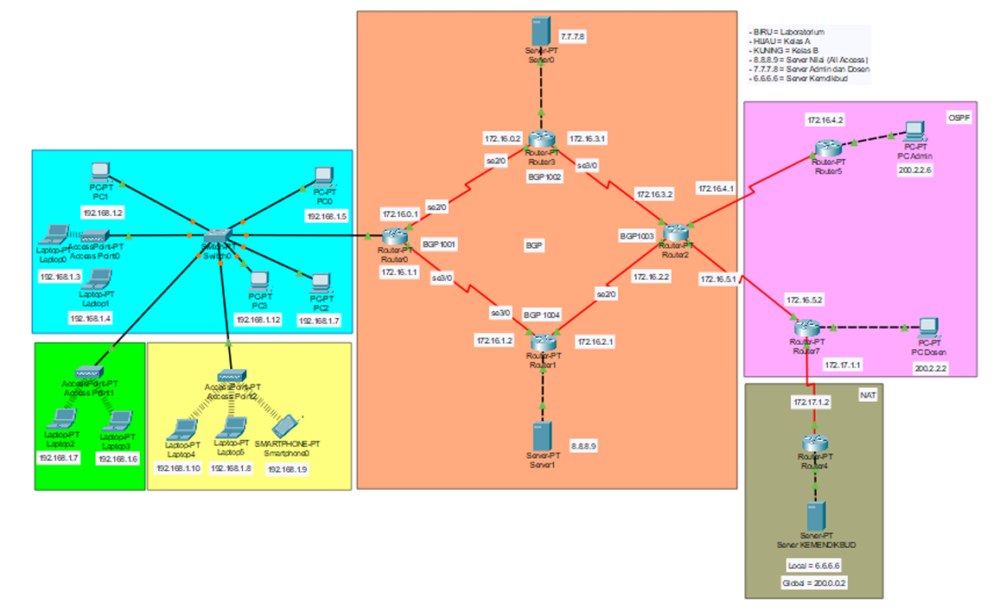

# Network Simulation & Secure AES Client-Server Chat Application

> Proyek gabungan yang mencakup **Simulasi Jaringan Komputer Kompleks (Cisco Packet Tracer)** berbasis OSPF, BGP, VLSM, ACL, & NAT, serta **Aplikasi Encrypted Chat Client-Server (Python)** menggunakan enkripsi AES-128 CFB mode.

---

## 📌 Ringkasan Proyek

Repositori ini terdiri dari dua bagian utama:
1. **Project Packet Tracer**: Perancangan dan simulasi jaringan enterprise/kampus yang menghubungkan area Laboratorium, Ruang Kelas, Ruang Dosen, Admin, dan Server Utama dengan routing gabungan BGP (EGP) dan OSPF (IGP).
2. **Aplikasi Chat Client-Server**: Pengembangan aplikasi obrolan (*real-time chat*) berbasis Python Socket, Tkinter GUI, multithreading, dan pengamanan transmisi data menggunakan enkripsi **AES-128 CFB Mode**.

---

## 🛠️ Simulasi Jaringan (Cisco Packet Tracer)

### 📐 1. Topologi Jaringan & VLSM
Jaringan dirancang untuk memenuhi kebutuhan akses bertingkat:
* **Area Mahasiswa**: Laboratorium, Kelas A, dan Kelas B (Subnet `192.168.1.0/28`).
* **Area Staf/Dosen & Admin**: Ruang Dosen & Ruang Admin (`200.2.2.0/30`).
* **Server Infrastructure**:
  * **Server Nilai (`8.8.8.9`)**: Dapat diakses oleh seluruh pengguna.
  * **Server Admin & Dosen (`7.7.7.8`)**: Hanya dapat diakses oleh staf admin dan dosen.
  * **Server Kemdikbud (`6.6.6.6`)**: Menghubungkan jaringan lokal ke server luar via NAT.

*Gambar 1: Topologi Logikal Jaringan Kampus & Core Routers*

### 🔀 2. Routing Protocol & Redistribusi
* **BGP (Autonomous Systems 1001–1004)**: Diterapkan pada router inti (`Router0`, `Router1`, `Router2`, `Router3`).
* **OSPF (Area 0)**: Diterapkan pada router internal (`Router2`, `Router5`, `Router7`).
* **Redistribusi BGP <-> OSPF**: Dikonfigurasi pada `Router2` sehingga segmen OSPF dan BGP dapat saling berkomunikasi secara mulus.

*Gambar 2: Skema Interkoneksi BGP dan OSPF*

### 🛡️ 3. Keamanan (ACL & NAT)
* **Access Control List (ACL)**: `Router3` menerapkan Standard ACL yang menolak (*deny*) subnet mahasiswa (`192.168.1.0/28`) untuk mengakses server khusus (`Server 0`).
* **Static NAT**:
  * `Router7` mentranslasikan IP internal Dosen (`200.2.2.2`) $\rightarrow$ IP Global (`50.0.0.2`).
  * `Router4` mentranslasikan IP internal Server Kemdikbud (`6.6.6.6`) $\rightarrow$ IP Global (`200.0.0.2`).

---

## 🔒 Aplikasi Encrypted Chat Client-Server (Python)

Aplikasi *chat* berbasis GUI yang mengamankan transmisi data menggunakan algoritma **AES-128 Mode CFB (Cipher Feedback)**.

### 🌟 Fitur Utama
* **End-to-End Encryption Concept**: Pesan dienkripsi sebelum dikirim via Socket TCP dan didekripsi di sisi penerima.
* **Tkinter GUI**: Antarmuka grafis yang ramah pengguna.
* **Multithreading**: Memisahkan antarmuka pengguna dengan *listener* jaringan agar aplikasi tetap responsif.
* **Packet Capture Security**: Mencegah *eavesdropping* / penyadapan (paket yang ditangkap di Wireshark berupa ciphertext tak terbaca).

*Gambar 3: Tampilan Antarmuka Chat Client (Tkinter)*

---

## 📊 Hasil Pengujian & Analisis Paket

### 1. Pengujian Akses Jaringan (Packet Tracer)
* **Akses Server Nilai (`8.8.8.9`)**: Berhasil diakses oleh Mahasiswa (PC1) dan Dosen.
* **Akses Server Kemdikbud (`200.0.0.2`)**: Berhasil diakses oleh Dosen (via Static NAT), tetapi *Request Timeout* saat diakses oleh Admin (karena pembatasan aturan akses).
* **Akses Server Khusus (`7.7.7.8`)**: Berhasil diakses oleh Admin, namun di-block oleh ACL untuk Mahasiswa (PC3).

### 2. Analisis Paket Wireshark (Chat Application)
Saat dilakukan *sniffing* paket jaringan menggunakan Wireshark pada Port `8888`, *payload* pesan yang terkirim sepenuhnya terenkripsi dalam bentuk *byte array* (hex dump), membuktikan keamanan komunikasi dari serangan *Man-in-the-Middle (MitM)*.

*Gambar 4: Analisis Paket Wireshark Menunjukkan Payload Terenkripsi AES*

